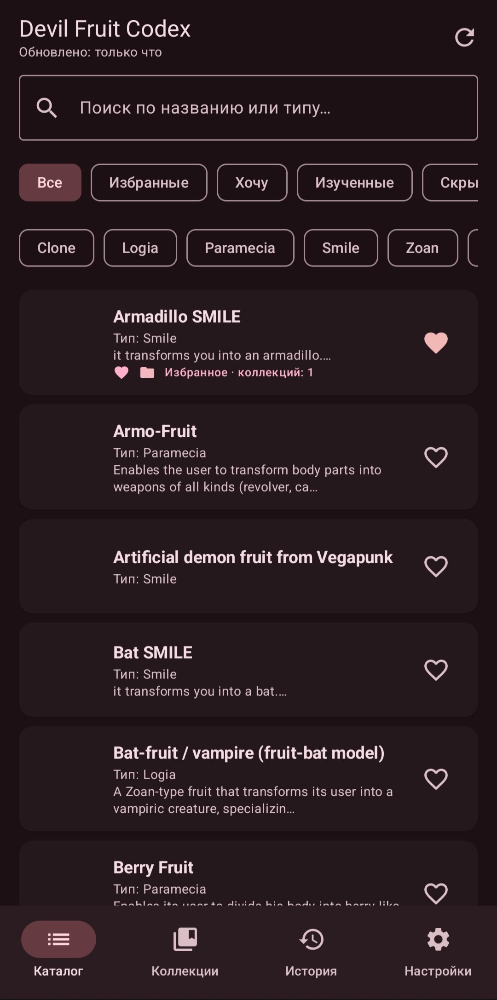
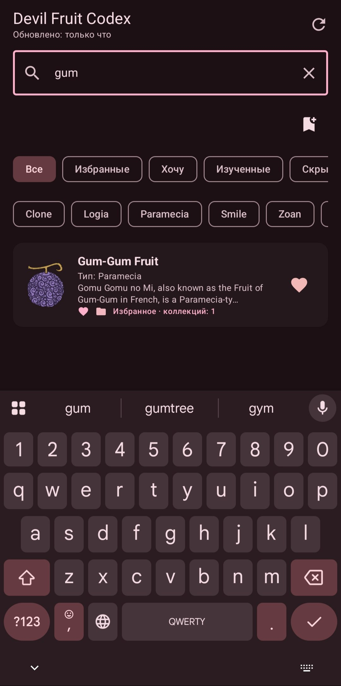
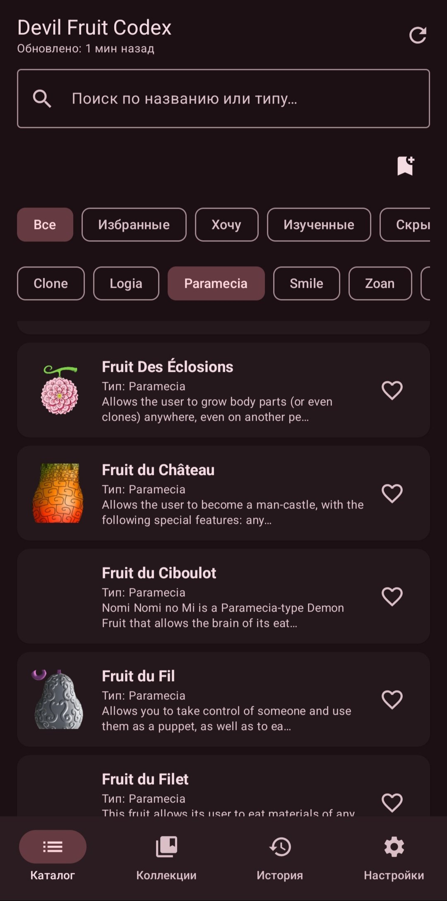
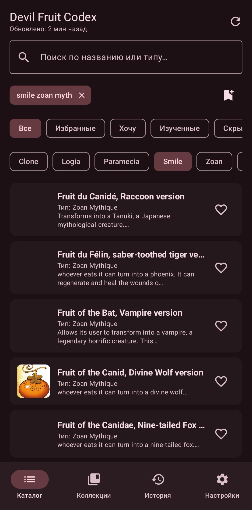
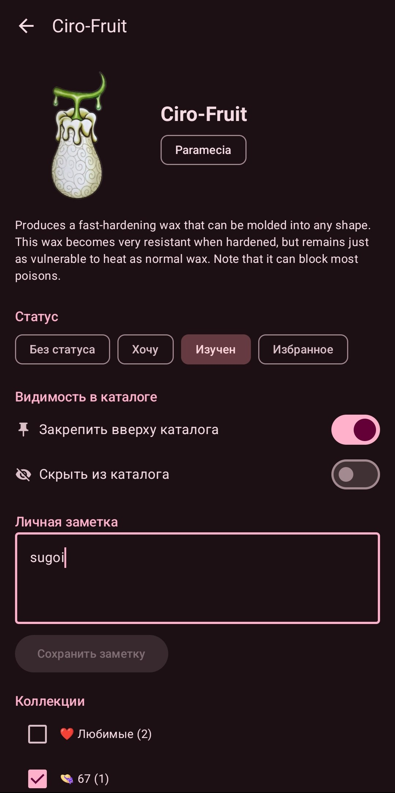
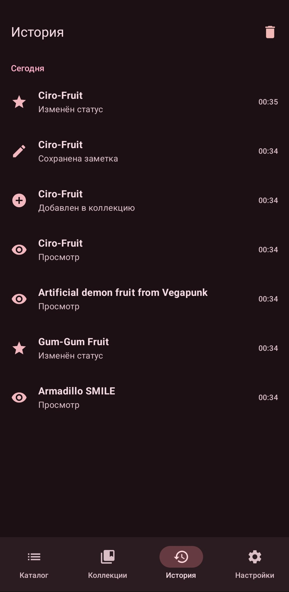
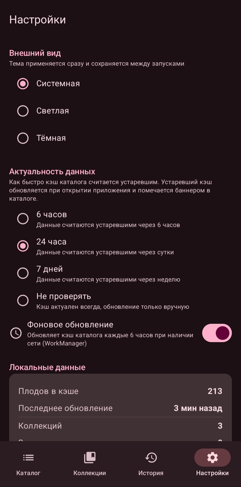
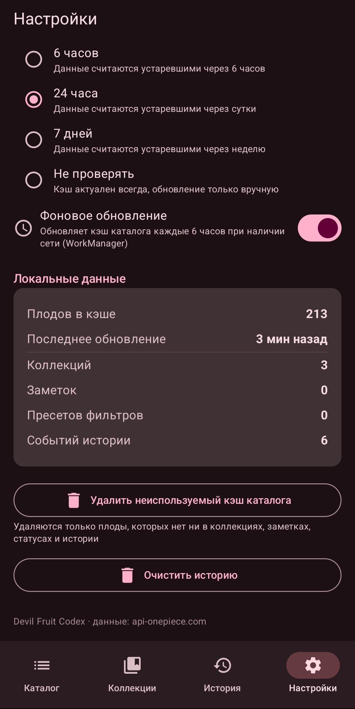

## Что было добавлено в финальной работе

| Слой | Добавлено |
|------|-----------|
| Данные | Room (7 таблиц, 6 DAO, связи M:N с каскадами), DataStore (настройки), TTL-политика кэша, offline-first `CatalogRepository` |
| Фоновая работа | WorkManager: периодическая синхронизация каталога с constraint'ами и retry-политикой |
| UI | Bottom navigation (Каталог / Коллекции / История / Настройки), переработанный каталог с фильтрами/пресетами/недавними, деталка со статусом и заметкой, экраны коллекций, история с группировкой по дням, настройки |
| Архитектура | Ручной DI (AppContainer), ViewModel на StateFlow + `combine`, фабрики, реактивный UI |
| Тесты | 59 unit-тестов на бизнес-логику, экранную логику и offline/sync |

## Новые пользовательские данные (Room)

- **Коллекции плодов** (`collections` + `collection_items`) — собственные именованные списки с эмодзи, закреплением и связью M:N к плодам. Удаление коллекции каскадно удаляет только её элементы, плоды остаются в каталоге. Системная коллекция **«Любимые»** создаётся автоматически при первом запуске и двусторонне синхронизирована со статусом «Избранное»: добавление плода в коллекцию ставит статус, а смена статуса обновляет состав; переименовать и удалить её нельзя.
- **Личные заметки** (`notes`) — заметка на каждый плод с временем обновления.
- **Пользовательские состояния плодов** (`fruit_user_state`) — статус (Хочу / Изучен / Избранное), закрепление наверху каталога, скрытие из каталога. Строки с дефолтным состоянием не хранятся вовсе.
- **Сохранённые пресеты фильтров** (`saved_filters`) — именованные наборы «статус + типы плодов + поисковый запрос».
- **История действий** (`history`) — просмотры, смена статусов, операции с коллекциями и заметками; подряд идущие одинаковые события дедуплицируются.

Настройки и только настройки (тема, TTL, автовключение фоновой синхронизации) живут в **DataStore** — база данных для предпочтений не используется, равно как и DataStore для пользовательских данных.

## Реализованные сценарии (5, из них 3 существенных)

1. **Offline-first каталог с TTL и фоновой синхронизацией** *(существенный)* — UI всегда читается из Room реактивно; сеть только обновляет кэш; TTL-политика (6 ч / 24 ч / 7 дней / никогда — из настроек) определяет устарелость; баннер «данные устарели», offline-баннер, обновление при старте если кэш пуст или устарел; пустой ответ API трактуется как ошибка и не затирает кэш.
2. **Личные коллекции** *(существенный, новые сущности + связь M:N)* — создание/переименование/удаление/закрепление коллекций (с эмодзи), добавление плодов из деталки, экран состава коллекции, каскадное удаление только элементов.
3. **Сохранённые пресеты фильтров** *(существенный, новая сущность)* — сохранение текущего фильтра как именованного пресета, применение в один тап, удаление, подсветка активного пресета.
4. **Статусы и заметки** — статусы (Хочу/Изучен/Избранное) переключаются из списка и деталки, влияют на фильтры каталога и бейджи карточек; закрепление поднимает плод наверх; скрытие убирает из выдачи (фильтр «Скрытые» возвращает); заметки редактируются в деталке. Прежнее «избранное» стало частью этой системы.
5. **История / Recent** — автозапись всех действий, группировка по дням («Сегодня/Вчера/дата»), секция «Недавние» на главном экране, очистка истории.

Обязательные экраны: **настройки**, **история**, персональные разделы (**коллекции**, **заметки/статусы**, **пресеты**).

## Как устроена offline-first часть

- **Room — источник истины.** Все экраны собираются из потоков БД (`Flow` → `combine` → `StateFlow` → `collectAsStateWithLifecycle`). Состояние экрана никогда не является прямым ответом сервера.
- **Сеть — только обновление кэша.** `CatalogRepository.refresh()` качает каталог и делает `@Upsert` в `fruits` с меткой `cachedAt`. При `IOException` возвращается `Error(offline = true)` — локальные данные остаются, UI показывает offline-баннер вместо ошибки.
- **Политика актуальности.** `CatalogTtlPolicy` — чистый класс: кэш пуст или старше TTL ⇒ «устарел». TTL берётся из настроек. Устаревший кэш обновляется при старте приложения и подсвечивается баннером.
- **Защита кэша.** Пустой ответ API — ошибка, старые данные не затираются. Очистка кэша из настроек удаляет только плоды, не задействованные в пользовательских данных (проверяется по всем пользовательским таблицам).
- **Картинки.** Coil с дисковым кэшем (64 МБ) — изображения доступны без сети; единый фиксированный размер с обрезкой (`ContentScale.Crop`) во всех списках и деталке.

Без интернета приложение полноценно работает: каталог, деталки, коллекции, заметки, статусы, история, фильтры и пресеты — всё локально.

## Фоновая обработка (WorkManager)

`CatalogSyncWorker` (CoroutineWorker) периодически (каждые 6 часов, только при наличии сети, экспоненциальный backoff, до 3 попыток) вызывает `catalogRepository.refresh()`. Логика синхронизации вынесена в репозиторий, воркер — тонкая обёртка; retry-решение — чистая функция `shouldRetry` (протестирована).

Управление — реактивное: настройка «Фоновое обновление» в DataStore включает/выключает уникальную periodic-задачу (`enqueueUniquePeriodicWork` / `cancelUniqueWork`). Воркер получает зависимости через кастомную `WorkerFactory` + `Configuration.Provider` (ручная инициализация WorkManager).

## Тесты (59, все JVM unit)

| Область | Тесты |
|---------|-------|
| Бизнес-логика | `CatalogTtlPolicyTest` (6), `FilteringTest` (9) — фильтры по статусам/типам/запросу, скрытие, сортировка с закреплением; `UserdataRepositoryTest` (12) — коллекции, каскады, системная коллекция «Любимые» и её синхронизация со статусами, заметки, пресеты; `HistoryRepositoryTest` (5) — дедупликация событий, недавние, очистка |
| Offline / sync / background | `CatalogRepositoryTest` (7) — успех, сетевая ошибка с сохранением кэша и offline-флагом, http-ошибка, пустой ответ, защита кэша, чистка; `SyncRetryPolicyTest` (3) — retry-решение воркера |
| Экранная логика | `CatalogViewModelTest` (8) — первичная загрузка, ошибки сети с кэшем и без, TTL-устаревание, фильтры, пресеты, недавние; `FruitDetailViewModelTest` (5) — запись истории, membership в коллекциях, заметки, статусы; `HistoryGroupingTest` (3) — группировка по дням |

Тесты используют in-memory фейки DAO (DAO — интерфейсы Room), фейковый API и `TestDispatcher` — быстро и стабильно.

## Скрины

